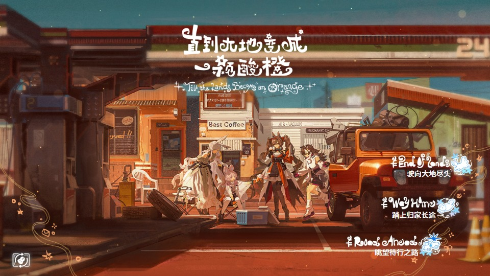
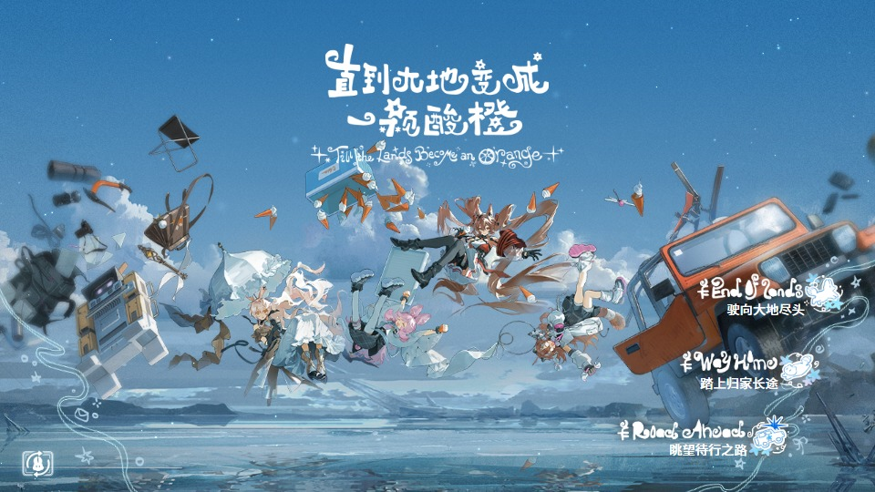
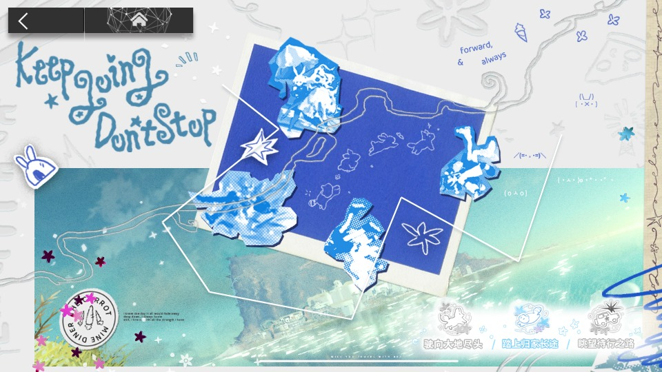
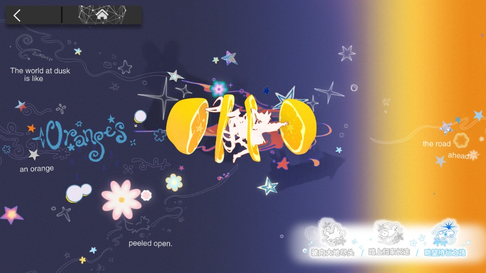
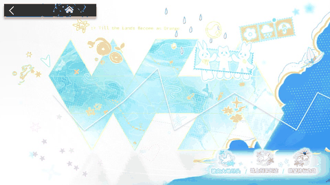

# 直到大地变成一颗酸橙 — Event UI Recreation

[简体中文](README.md)

An unofficial Arknights browser recreation featuring the road intro, two home illustrations, and Normal / EX / S maps.

## Preview


| Street home | Sky home |
| --- | --- |
|  |  |

| Normal map | EX map | S map |
| --- | --- | --- |
|  |  |  |



## Run

Requires **Node.js 22+** and a desktop browser with **WebGL 2**. No npm dependency installation is needed.

On Windows, double-click `start-preview.cmd`, or open a terminal in this folder and run:

```sh
npm start
```

Open http://127.0.0.1:4173/ in your browser. Keep the terminal open; press Ctrl+C to stop. Do not open the HTML file directly.

If the port is busy, run `$env:PORT='4174'; npm start` in PowerShell and open http://127.0.0.1:4174/ .

## Controls

| Action | Result |
| --- | --- |
| Bottom-left home icon / B | Switch home illustration |
| Right-side home entries | Open Normal / EX / S map |
| Bottom-right map tabs | Switch chapter |
| Top-left map button / Esc | Return home |
| Drag / mouse wheel on Normal map | Scroll horizontally |
| Space / R / H | Pause or resume / replay / toggle toolbar |

The toolbar also offers speed, timeline and fullscreen controls. If the animation appears frozen, remove `?frame=` from the URL. For loading problems, check Node.js and browser hardware acceleration.

## Scope

No combat, account system or audio. Some UI, logos, stage nodes and balances are intentionally omitted. Materials, particles and transitions include approximations; frame-by-frame equivalence with the original has not been established. Previews are captured from this implementation.

## Sources, licenses and disclaimer

This is an unofficial recreation, with no affiliation to [Hypergryph](https://www.hypergryph.com/) or the relevant rights holders. Original code and documentation are [MIT licensed](LICENSE). Arknights artwork, logos, textures, animation, layout, material and mesh data belong to their respective rights holders and are not covered by that license. Screenshots, GIFs and videos contain the same game assets and do not grant additional rights. Attribution does not constitute permission to redistribute those assets.

`NotoSansHans-Medium.otf` is unchanged. Its embedded copyright is © 2014 Adobe Systems Incorporated, and its embedded license statement specifies Apache 2.0. The [font notice](assets/fonts/NotoSansHans-NOTICE.txt) and [Apache 2.0 license](assets/fonts/Apache-2.0.txt) are included. This attribution follows the actual font file, not newer releases of the font family.

References: [original demonstration](https://www.bilibili.com/video/BV1mQ4R6gEfj/) · [recreation video](https://www.bilibili.com/video/BV14aYL6GEbx/) · [arknights-motion-library](https://github.com/Ulchemist/arknights-motion-library). The videos are references for appearance and timing; copies are not included in the release. Listing a recreation project does not claim reuse of its code.

<details>
<summary>Asset provenance</summary>

- Game resources come from event `act53side`, historical version `26-08-07-14-53-29_30b8f0`; the original AB has MD5 `ca93746869f49db6b59c1be4d971cfef`.
- Derived assets reside in `assets/native`. The event bundle contains 477 image entries and 24 AnimationClips; layout, animation and road mesh data are represented by `scene.json`, `road-mesh.json` and `chapters/layout.json`.
- Back/home navigation images originate from client `sharedassets1.assets`, Sprite 448 / 638. The font is Font 357, version 1.000; name-table entries 13/14 declare Apache 2.0 ([official text](https://www.apache.org/licenses/LICENSE-2.0.txt)).
- Original bundles, UnityPy extraction tools and research evidence remain in the development folder and are excluded from the runtime package. UnityPy is not a runtime dependency.

</details>
